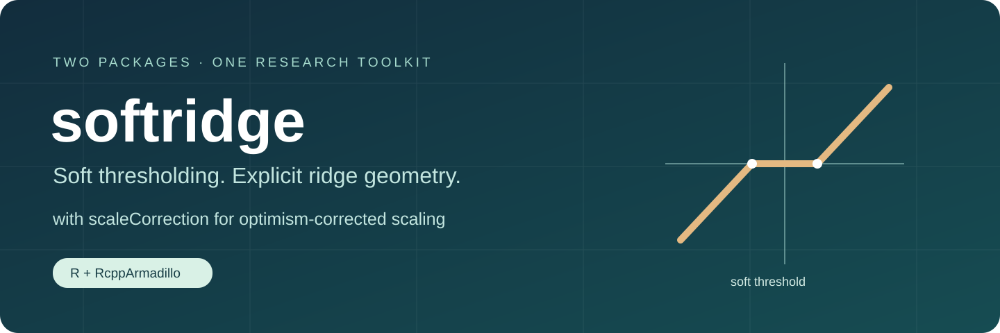

# Soft-thresholded ridge, from theory to reproducible code

**softridge** fits soft-thresholded ridge (STR), computes fixed-parameter
Gaussian risk and SURE, and supports cross-validation and least-squares refitting.
Its **scaleCorrection** companion fits optimism-corrected scaled STR (SSTR)
alongside a matched Ridge-c0 control. Numerical kernels use **RcppArmadillo**.

[Get started](https://byuzbasi.github.io/softridge/articles/getting-started.html) ·
[Function reference](https://byuzbasi.github.io/softridge/reference/index.html) ·
[Scaling companion](https://byuzbasi.github.io/softridge/scaleCorrection/) ·
[Reproduce the studies](https://byuzbasi.github.io/softridge/articles/reproduction.html)

## Two packages, complementary roles

| Package | Purpose | Entry points |
|:--|:--|:--|
| softridge | STR fitting, fixed-tuning risk and SURE, CV, LS refitting | `hr()`, `cv_hr()`, `hr_risk()`, `hr_sure()` |
| scaleCorrection | Corrected SSTR and matched Ridge-c0 tuning on a shared CV surface | `corrected_pair()` |

The manuscript calls the estimators **STR** and **SSTR**. Historical function
names such as `hr()` are retained for compatibility. `scale = TRUE` in
`hr()` or `cv_hr()` requests the earlier training LS scale (**SSTR-LS**);
the corrected SSTR is obtained from [`scaleCorrection::corrected_pair()`](https://byuzbasi.github.io/softridge/scaleCorrection/reference/corrected_pair.html).

## Install from GitHub

R, a working C++17 toolchain, and the declared package dependencies are required.
Install `remotes` separately if it is not already available, then run:

```r
remotes::install_github("byuzbasi/softridge", upgrade = "never")
remotes::install_github("byuzbasi/softridge", subdir = "companion/scaleCorrection",
                        upgrade = "never")
```

These are GitHub research packages; no CRAN availability is claimed.
Dependency lists and recorded study environments are documented in the guides.

## A small STR fit

```r
library(softridge)
set.seed(25)
X <- matrix(rnorm(60 * 100), 60, 100)
beta <- c(2, -1.5, 1, rep(0, 97))
y <- drop(X %*% beta + rnorm(60))
foldid <- rep(1:3, length.out = 60)
grid <- hr_grid(X, y, nk = 3, ng = 5)
fit <- cv_hr(X, y, grid = grid, foldid = foldid)
head(fit$coef)
```

This is a software demonstration, not a simulation performance result.
The [scaling guide](https://byuzbasi.github.io/softridge/articles/scaling.html)
shows the corrected SSTR and its matched Ridge control using the same observations.

## Example gallery

[Threshold geometry](https://byuzbasi.github.io/softridge/articles/getting-started.html#threshold-geometry)
and a [fixed-design exact-risk curve](https://byuzbasi.github.io/softridge/articles/risk-and-targets.html#a-fixed-design-analytic-illustration)
are analytic software demonstrations with their seeds and source code stated.

## What the theory computes

`hr_risk()` evaluates coefficient risk for the estimable projection under
a fixed Gaussian design model. `hr_sure()` evaluates fixed-design prediction
risk with fixed tuning and known error variance. New-covariate prediction
and recovery of the original coefficient support are distinct objectives.
The corrected fitted scale and data-adaptive tuning are assessed empirically;
the fixed-parameter unbiasedness formulas do not extend automatically to them.

## Reproduction materials

[`reproduction/`](https://github.com/byuzbasi/softridge/tree/main/reproduction) contains source packages, frozen designs/seeds
and portable runners for the separately reported **22-setting reference study**
and **192-scenario independent study**. The reference uses the original R
`softridge` 0.4.0; the independent study uses RcppArmadillo `softridge` 0.3.0.1
and `scaleCorrection` 0.1.0. Their CV protocols differ and are not pooled.
Original archives are retained byte for byte in separate library workflows.

```sh
cd reproduction
python3 verify_sources.py
Rscript --vanilla RUNME.R --help
```

No full study runs automatically. Downloading real data and starting a full
numerical rerun both require explicit commands. Saved result tables and
manuscript PDFs are distributed separately from this software repository.

## Citation and authorship

Software: Mohammad Arashi and Bahadir Yuzbasi. See [`CITATION.cff`](https://github.com/byuzbasi/softridge/blob/main/CITATION.cff)
and `citation("softridge")` / `citation("scaleCorrection")`.

Companion manuscript: Bahadir Yuzbasi and Mohammad Arashi,
*Soft-thresholded ridge estimation of an estimable projection*, unpublished
manuscript (2026). No journal acceptance or DOI is claimed.

## Development and validation

See [VALIDATION.md](VALIDATION.md), [CONTRIBUTING.md](CONTRIBUTING.md),
and [release notes](https://byuzbasi.github.io/softridge/news/index.html). Report reproducible problems through
[GitHub issues](https://github.com/byuzbasi/softridge/issues).
Both packages use GPL (>= 2); original authorship is preserved.
