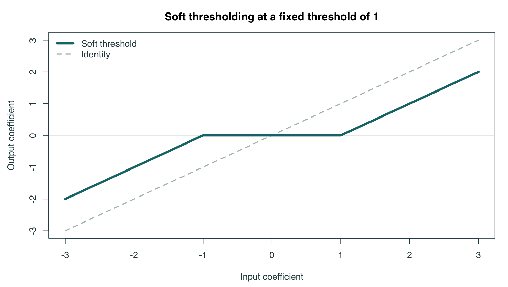

`softridge` is the STR engine; `scaleCorrection` adds the corrected fitted
scale. Both use RcppArmadillo. Install the main package before its companion.

```{r install, eval=FALSE}
remotes::install_github("byuzbasi/softridge", upgrade = "never")
remotes::install_github("byuzbasi/softridge", subdir = "companion/scaleCorrection",
                        upgrade = "never")
```

## Fit STR on a small example

```{r str-fit}
library(softridge)
set.seed(25)
X <- matrix(rnorm(60 * 100), 60, 100)
beta <- c(2, -1.5, 1, rep(0, 97))
y <- drop(X %*% beta + rnorm(60))
foldid <- rep(1:3, length.out = nrow(X))
grid <- hr_grid(X, y, nk = 3, ng = 5)
fit <- cv_hr(X, y, grid = grid, foldid = foldid)
c(k = fit$k, threshold = fit$gamma, selected = length(fit$selected))
head(fit$coef)
```

The coefficient vector starts with the intercept. `hr()` returns a path object;
its standard `coef()` and `predict()` methods select a path location.
The following in-sample predictions illustrate the API, not prediction accuracy.

```{r path-predict}
path <- hr(X, y, k = fit$k, gamma = fit$gamma)
head(predict(path, X))
```

## Manuscript names and code entry points

| Manuscript name | Code | Scale |
|:--|:--|:--|
| STR | `hr()` / `cv_hr()` | None |
| STR-OLS | `cv_hr(..., refit = TRUE)` | Selected-variable LS refit |
| SSTR-LS | `cv_hr(..., scale = TRUE)` | Training LS scale |
| SSTR | `scaleCorrection::corrected_pair()$SSTR_c0` | Corrected scale |
| Ridge-c0 | `scaleCorrection::corrected_pair()$Ridge_c0` | Corrected zero-threshold control |

## Small-example provenance

This 60-by-100 Gaussian example uses seed 25, three supplied folds and a
3-by-5 grid. It demonstrates software interfaces. It is not one of the reported
performance comparisons and does not establish a method ranking.

## Threshold geometry

The illustration below evaluates the deterministic soft-threshold operator;
it contains no estimated performance results. Source: `tools/build-gallery.R`.

```{r geometry, echo=FALSE, out.width="100%", fig.alt="Piecewise linear soft threshold operator at threshold one"}

```
